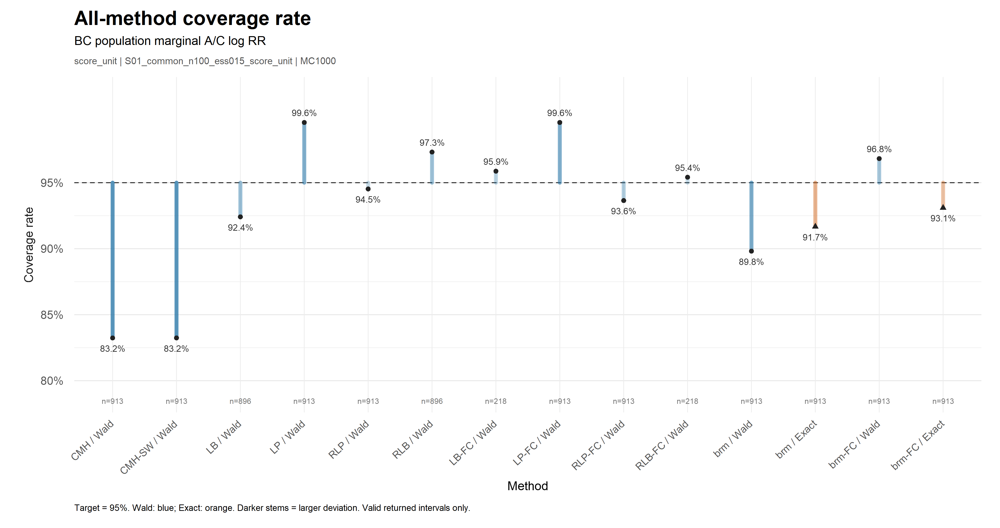
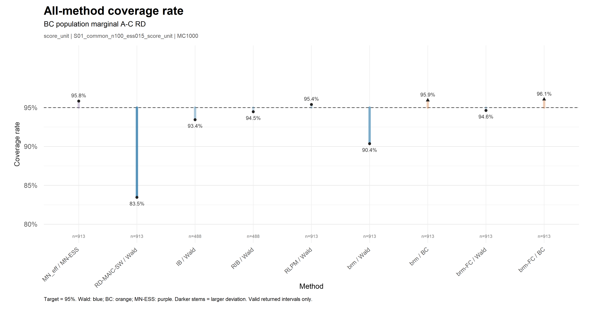

# 最新 Nibi 绘图与汇总

RR、RD各24个分析情景，三种分析各8个，均为MC1000。STC RR按两种不确定性范围各展示8个情景。

| 内容 | 入口 |
|---|---|
| RR图表 | [RR](RR) · [全部指标](RR/metrics_all_runs.csv) |
| RD图表 | [RD](RD) · [全部指标](RD/metrics_all_runs.csv) |
| RR/RD情景检索 | [SCENARIOS.csv](SCENARIOS.csv) |
| RR/RD合并指标 | [metrics_all.csv](metrics_all.csv) |
| STC RR图表 | [STC_RR](STC_RR) · [指标](STC_RR/metrics_all_runs.csv) · [情景检索](STC_RR/SCENARIOS.csv) |
| 绘图与coverage代码 | [code/plotting](../code/plotting/README_zh.txt) |
| 输入和数值核对 | [validation](validation) |

每个情景目录包含四张PNG（Bias、SE、Accuracy、Coverage）、四页PDF、指标CSV和说明。图表依据当前逐次CSV重新生成，计算过程中不重新拟合模型或计算区间。
Coverage以有效返回且有对应真值的区间为分母；返回率和占计划MC1000的覆盖比例同时保存。Accuracy用同一有效SE子集计算。
失败状态原样保留。RR图为延续原展示规则而省略少数方法，完整指标表和原始CSV包含全部方法。

## 图表预览

## 源汇总包

[source_summaries](source_summaries) 保留 Nibi 提供的汇总导出及原校验文件。
其中 RR_none_summary 和 RD_none_summary 来自 full24 的 `none`（单位拟合权重），与当前主结果的 `none_MAIC` 不是同一设置；它们只作补充来源，不能替代none_MAIC。
统一指标和图表以当前48份逐次CSV为准；RD none_MAIC已直接从其最新逐次CSV汇总。
