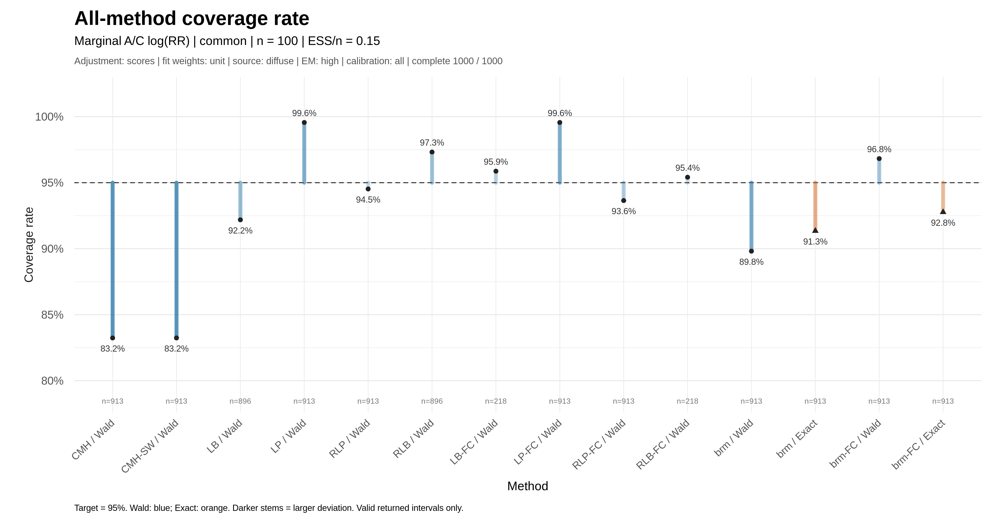
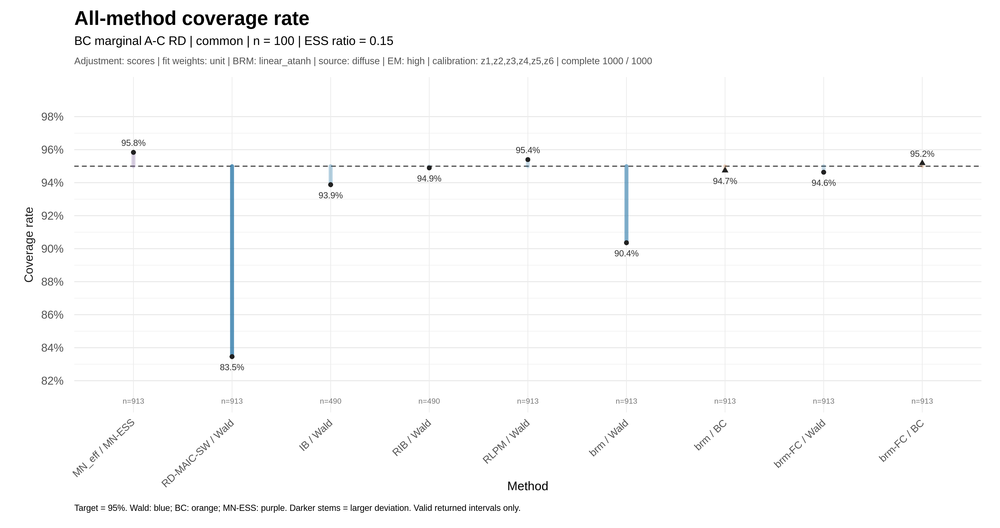

# RR / RD plotting results

当前 `result_v2` 绘图结果，2026-10-22 上传。每尺度 288 个情景，每情景 MC1000；各含 scores/unit 144 个和 none/MAIC 144 个。

| 结果 | 情景目录 | 汇总指标 | 原绘图索引 |
|---|---|---|---|
| RR | [RR](RR) | [metrics_all_runs.csv](RR/metrics_all_runs.csv) | [run_index.csv](RR/run_index.csv) |
| RD | [RD](RD) | [rd_plot_metrics_all_runs.csv](RD/rd_plot_metrics_all_runs.csv) | [rd_plot_run_index.csv](RD/rd_plot_run_index.csv) |

每个情景包含 `bias.png`、`se.png`、`accuracy.png`、`coverage.png`、四页 `metrics.pdf`、`metrics.csv` 和 `analysis_notes.txt`。
共 2304 张 PNG、576 份 PDF。可用 [SCENARIOS.csv](SCENARIOS.csv) 按事件类型、ESS、样本量、校准集和估计模式查找本仓库内的相对路径。

RR 指标采用 log(RR) 尺度，RD 采用自然 RD 尺度；图中 RR 的 `Exact` 标签对应 BC 计算程序。
Coverage 以有效返回区间为分母；区间返回比例等指标见各情景 CSV。不同方法的有效重复数可能不同。

## 图表预览

以下两个示例均为 common / diffuse / high / all / scores-unit / n=100 / ESS=0.15。

### RR

[查看该情景的全部图片、PDF和指标](RR/batch_01_scores_common/common_diffuse_high_weight_all_est_scores_fit_unit_n100_ess015_full_20261015_171815_1874482)

### RD

[查看该情景的全部图片、PDF和指标](RD/batch_01_scores_common/RD_common_diffuse_high_weight_all_est_scores_fit_unit_brm_linear_atanh_n100_ess0.15_full_20261014_124515_06VFjz)

## 对应代码与文件校验

- [绘图代码及运行方法](../code/plotting/README_zh.txt)
- [非 Wald 置信区间说明](../code/CI_methods/README_zh.md)
- [全部图表文件的 SHA256 清单](FILE_MANIFEST.csv)

图片、PDF、指标及原说明均按源文件字节复制。原索引/说明中的 scratch 路径保留作来源记录，本仓库导航使用 `SCENARIOS.csv` 的相对路径。
本目录保存图形和结果汇总，不含集群逐 seed 的完整 RDS；上传时没有重新拟合模型或重算 CI。
